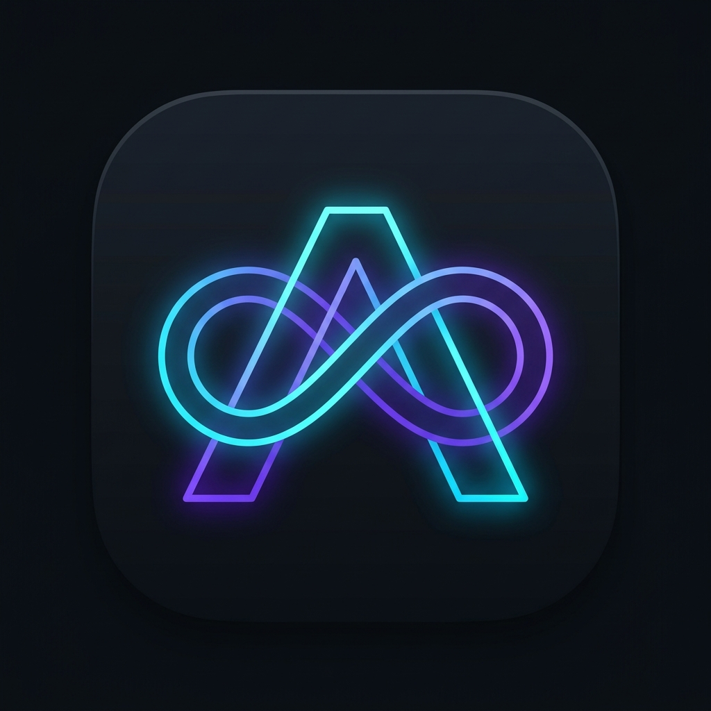

<div align="center">

<h1 style="color: #FF2B2B;"><strong>⚠️ ВНИМАНИЕ: Проект находится в стадии активной разработки (Work In Progress) и ещё НЕ ДОРАБОТАН! ⚠️</strong></h1>
<h3 style="color: #FF4444;"><strong>WARNING: This project is a Work in Progress (WIP) and is NOT YET COMPLETE or stable! Use strictly at your own risk.</strong></h3>

<br />



# AnyGSI
**Универсальный переключатель пространств пользователя и GSI-контейнеризация для Android**<br />
*Universal Android Userspace Switcher & On-the-Fly GSI Container Engine*

[](#)
[](#)
[](#)
[](#)

</div>

---

> [!CAUTION]
> ### 🔴 ВАЖНОЕ ПРЕДУПРЕЖДЕНИЕ / DISCLAIMER
> **Приложение подменяет ключевые системные службы работающей ОС (`zygote`, `surfaceflinger`, `system_server`).**
> Данное решение изначально исследовалось и тестировалось на Samsung Galaxy (One UI 8.5 / 9.0, Android 16/17). На других устройствах, прошивках или версиях ядра возможны зависания, краши, циклические перезагрузки (bootloop) или сбои сети/SMS. **Обязательно сделайте полный бэкап устройства перед использованием!**

---

## 📖 О проекте (About AnyGSI)

**AnyGSI** позволяет «на лету» (hot-switch) переключаться между стоковой прошивкой производителя (например, **Samsung One UI**) и произвольным **GSI-образом** (LineageOS, Pixel Experience, AOSP, Android 16 / 17) на rooted-устройствах без перепрошивки разделов, без разметки второго диска и без длительной перезагрузки ядра.

AnyGSI разворачивает окружение GSI в изолированной файловой системе (`/data/lineage/`), изолирует точки монтирования через Linux Mount Namespaces (`unshare -m`), выполняет `pivot_root` и запускает гостевой `zygote` и `system_server` под контролем нативного бинарника `zygote_exec`. При необходимости экран и службы мгновенно возвращаются обратно в One UI.

---

## ⚡ Ключевые возможности

* **Запуск любого GSI (.img):** Поддержка выбора любых ARM64 GSI (Android 15, 16, 17, LineageOS 23+).
* **Изолированное окружение (`/data/lineage`):** Реальные директории хоста (`/data/app`, `/data/user/0`, `/data/media/0`) защищены от перезаписи UID/GID и порчи SELinux-контекстов гостевой системой.
* **One UI Protection & Recovery Engine:**
  * **Backup One UI Layout & QS:** Автоматический и ручной бэкап баз данных рабочего стола (`com.sec.android.app.launcher`), виджетов (`appwidgets.xml`), настроек и плиток шторки Quick Settings (`sysui_qs_tiles`).
  * **Restore One UI (Storage, Home & QS):** Комплексный скрипт `restore_host.sh` для полного восстановления прав системных каталогов, внутренней памяти (`/data/media/0`), принудительного `restorecon -FR` и мгновенного перезапуска SystemUI и лаунчера без перезагрузки телефона.
* **Поддержка KernelSU & Magisk:** Динамический поиск root-окружения (`/data/adb/ksud debug su`, `/data/adb/ksu/bin/su`, `/data/user_de/0/df.root/ksud`, `/system/bin/su`, `su`).
* **Аппаратная адаптация:**
  * Встроенный `watchdog_feeder` для предотвращения kernel panic от сторожевого таймера.
  * Тюнинг аудио с ультранизкой задержкой (Low-Latency bypass deep buffer).
  * BPF-маршрутизация сети (`net_fix.sh`) для передачи трафика между гостевым ConnectivityService и хостовым netd.
  * Keepalive-супервайзеры для сотовой сети/SMS (`imsd`) и ADB-соединения (`adbd`).

---

## 📁 Структура проекта

| Путь | Назначение |
| --- | --- |
| `src/com/wewaffles/anygsi/` | Исходный код Android-приложения (`MainActivity`, `RootReceiver`) |
| `res/` | Разметка Material 3, адаптивные иконки и ресурсы AnyGSI |
| `assets/restore_host.sh` | Скрипт полного восстановления хостовой среды One UI, памяти, прав и интерфейса |
| `assets/backup_host.sh` | Скрипт создания снапшота рабочего стола, виджетов и шторки QS |
| `assets/switch_to_lineage.sh` | Главный оркестратор переключения с One UI на GSI-контейнер |
| `assets/return_to_oneui.sh` | Скрипт возврата экрана и сервисов в стоковую One UI |
| `assets/master_prepare.sh` | Подготовка точек монтирования rootfs, APEX-модулей и изолированных данных |
| `assets/master_inner.sh` | Выполняется внутри `unshare -m` и `pivot_root`, запускает Zygote |
| `src/native/zygote_exec.c` | Нативный супервайзер гостевого Zygote |
| `src/native/watchdog_feeder.c` | Аппаратный фидер сторожевого таймера ядра Linux |
| `build_apk.sh` | Автономный скрипт компиляции и подписи APK без Android Studio |
| `AnyGSI.apk` | Готовый собранный исполняемый установочный пакет |

---

## 🛠️ Требования

1. Устройство с архитектурой **ARM64** с root-доступом (**KernelSU** рекомендуется, либо Magisk).
2. Достаточно свободного места на разделе `/data` (от 4 до 10 ГБ в зависимости от размера GSI-образа).
3. Образ GSI в формате `.img` (ARM64, AB / Read-Only или Read-Write).

---

## 🔨 Сборка APK

Для сборки проекта не требуется Android Studio — достаточно установленного Android SDK и JDK:

```bash
chmod +x build_apk.sh
./build_apk.sh
```

Готовый файл сохраняется в корне проекта: `AnyGSI.apk`.

---

## ⚠️ Известные ограничения текущей версии

- Проект находится в стадии **активного прототипирования (Alpha)**.
- Голосовые вызовы через IMS в гостевой системе требуют дополнительной настройки RIL.
- В гостевом GSI некоторые функции разработчика могут перезапускать USB-стек (контролируется `adb_watchdog.sh`).
- В случае сбоя используйте встроенную кнопку **«Restore One UI (Storage, Home & QS)»** или выполните в root-терминале:
  ```sh
  /system/bin/sh /data/lineage/restore_host.sh
  ```

---

## 📄 Лицензия и благодарности

Разработано для сообщества открытого Android-моддинга.
Используются наработки сообщества GSI (MisterZtr, Phh/treble_experimentations).
Android и One UI являются зарегистрированными товарными знаками соответствующих правообладателей.
